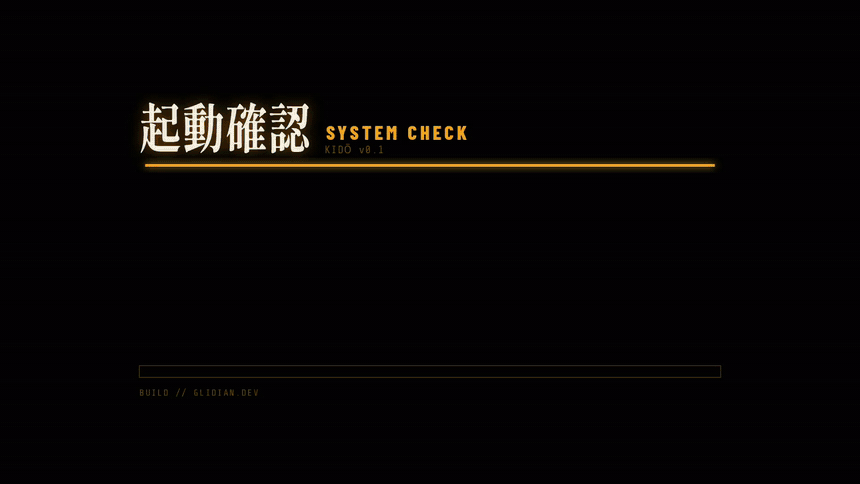
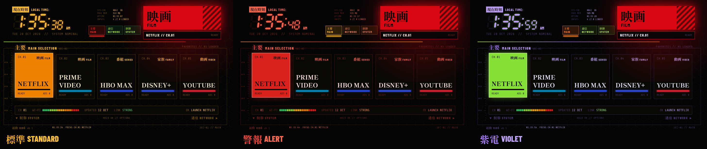
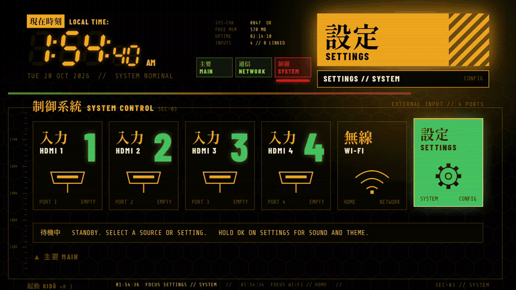
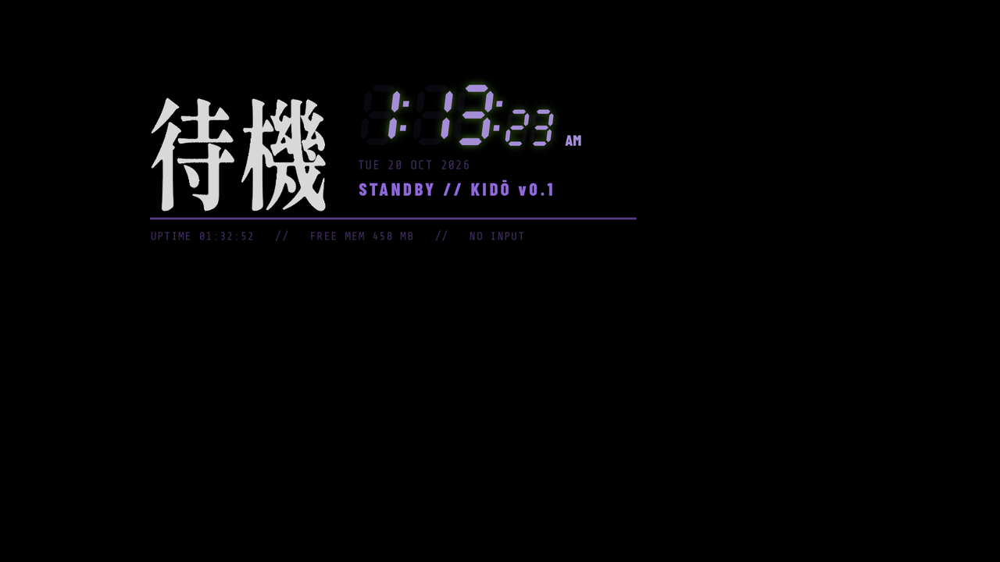

# 起動 KIDŌ

A command-center home screen for Android TV. A seven-segment clock, big Mincho kanji, a honeycomb of
channels, live readouts and a status block that lights up in the color of whatever you're on. No ads,
no rows of recommendations, no internet access at all.



*Recorded on a Sharp AQUOS 4K TV. KIDŌ (起動) means "start up".*

**Android TV 8.0+ · 235 KB · no internet permission · free and open source (MIT)**

**Try it in your browser:** [glidian.dev/kido/demo](https://glidian.dev/kido/demo/) (arrow keys and Enter are the remote)

## What's on screen

- **Main panels.** Your five favorite apps as big cards, with a readout under them: channel, real
  Wi-Fi strength, when the app last updated, and the link quality.
- **Network link.** Every other app as a honeycomb, with a link status panel listing them all.
- **System control.** Your HDMI inputs, Wi-Fi and Settings. Plug something in and an
  `入力検知 INPUT DETECTED` panel drops in; press OK to switch to it.
- **The HUD.** A seven-segment clock, a live data block (free memory, uptime, inputs), section tabs
  and a footer log of what you've been doing.
- **Little things.** A system check once per TV boot, sections that trace themselves in as you arrive,
  a launch screen when you open an app, soft console beeps, a faint hex grid and scanlines.
- **Keeps itself up to date.** Install or remove an app and KIDŌ rebuilds itself. The clock follows your
  TV's 12 or 24-hour setting.
- **Easy on the eyes.** Nothing flashes quickly: the input alert pulses slowly, and holding an arrow
  moves at a steady pace instead of strobing colors across the screen.
- **KIDŌ Standby.** A screensaver that protects your screen from burn-in (see [below](#screensaver)).

## Themes

Three color themes. Hold OK on **Settings** to pick one (and to turn the beeps on or off).





## Screensaver

KIDŌ Standby is a matching screensaver: a big 待機 (standby), the clock and a few live readouts on black.
The whole block glides to a new spot every 20 seconds and sits slightly dimmed, so nothing stays in one
place long enough to burn in. That matters most on OLED TVs.



Turn it on in Settings > Device Preferences > Screen saver > **KIDŌ Standby**. It uses whichever theme
KIDŌ is set to, and the TV starts it after the idle time you set there.

## Using it

| Remote | What it does |
|---|---|
| Arrows | Move around. Left and right run through everything in reading order, from the main panels through the honeycomb to Settings |
| OK | Open the app or input |
| Hold OK on an app | Move it, pin it to the main panels, unpin it, or open its app info |
| Hold OK on Settings | Sound on or off, and the color theme |
| Back | Return to the main panels |
| Home | Back to KIDŌ from anywhere, once it's your Home screen |

## Install

> [!NOTE]
> KIDŌ isn't on the Play Store; you install it yourself with adb. So far it's been tested on one TV
> (see [Tested on](#tested-on)). Other Android TVs should work, but if something looks off on yours,
> please open an issue.

You'll need a computer with [adb](https://developer.android.com/tools/releases/platform-tools) and
the TV on the same network.

1. On the TV, turn on Developer options (Settings > Device Preferences > About, press OK on
   **Build** seven times), then turn on **USB debugging** or **Network debugging** in Developer options.
2. Find the TV's IP address (Settings > Network) and connect:
   ```bash
   adb connect 192.168.1.50:5555
   ```
   Accept the prompt on the TV.
3. Download `kido.apk` from [Releases](../../releases) and install it:
   ```bash
   adb install kido.apk
   ```

KIDŌ now shows up in your apps. To make it what the Home button opens:

```bash
adb shell cmd package set-home-activity dev.glidian.kido/.KidoActivity
```

Some TVs keep sending Home to the stock launcher anyway. If yours does, switch the stock launcher off
(this doesn't uninstall anything):

```bash
# Android TV
adb shell pm disable-user --user 0 com.google.android.tvlauncher
# Google TV
adb shell pm disable-user --user 0 com.google.android.apps.tv.launcherx
```

> [!IMPORTANT]
> Switching the stock launcher off is safe and easy to undo, but if you ever remove KIDŌ, turn the
> stock launcher back on **first**. See [Uninstall](#uninstall).

> [!TIP]
> Turn on the [KIDŌ Standby screensaver](#screensaver) too, to protect your screen from burn-in.

## Clean up the rest

If you'd like to clear out the rest of the preinstalled clutter too, take a look at
[cleanyourtv](https://github.com/Gathin23/cleanyourtv), which has tested debloat lists for a lot of TVs.

## Uninstall

> [!WARNING]
> If you switched the stock launcher off, turn it back on **first**. Otherwise the TV is left with
> nothing to show when you press Home.

Turn the stock launcher back on:

```bash
# Android TV
adb shell pm enable com.google.android.tvlauncher
# Google TV
adb shell pm enable com.google.android.apps.tv.launcherx
```

Then remove KIDŌ:

```bash
adb uninstall dev.glidian.kido
```

If you picked KIDŌ Standby as the screensaver, choose another one in Settings > Device Preferences >
Screen saver.

## Privacy

KIDŌ has no internet permission, so it can't send anything anywhere. It asks for two permissions,
both only to read the Wi-Fi signal for the readouts: `ACCESS_NETWORK_STATE` and `ACCESS_WIFI_STATE`.
Your pinned apps, theme and sound setting stay on the TV.

## Tested on

| TV | Android | Notes |
|---|---|---|
| Sharp AQUOS 4K | Android TV 11 | 1920x1080 interface; about 70 MB of memory in use, less than the stock launcher |

KIDŌ needs Android 8.0 or newer. It's laid out for a 16:9 screen and scales to any resolution. If you
run it on another TV, an issue or a pull request adding a row here is very welcome.

## Build from source

You'll need JDK 17 and the Android SDK (API 34).

```bash
./gradlew assembleDebug
adb install -r app/build/outputs/apk/debug/app-debug.apk
```

The whole interface is built in code, on a 1920x1080 grid that scales to the real screen. The app
catalog (names, kanji and brand colors for common apps) and the first-run favorites are in
`Kido.java`; anything not listed there still shows up, labelled アプリ APP.

## Credits

- KIDŌ started from [cleanyourtv](https://github.com/Gathin23/cleanyourtv) by Gathin, a project for
  stripping the clutter off Android TVs and building your own home screen. Thank you.
- Fonts, all under the SIL Open Font License: [Shippori Mincho B1](https://fonts.google.com/specimen/Shippori+Mincho+B1),
  [Barlow Condensed](https://fonts.google.com/specimen/Barlow+Condensed) and
  [Share Tech Mono](https://fonts.google.com/specimen/Share+Tech+Mono).
- Inspired by the command-center screens of a certain 90s anime about giant robots and very big feelings.

App names belong to their owners; KIDŌ just uses them as labels.

## License

MIT. See [LICENSE](LICENSE).

---

Made by [Glidian](https://glidian.dev).
